<div align="center">

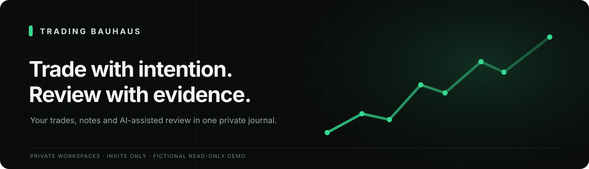

<br/>

# Trading Bauhaus · AI Trading Journal

**Claude & OpenAI BYOK AI Trading Analyst · OHLC Candle Replay · Open Edge Score v2 · 22 Broker Syncs · Local-First SQLite**

A dark-first, Bauhaus-inspired **AI trading journal** for futures, stocks, forex, and crypto traders. Audit every execution with grounded **Claude / OpenAI** session critiques, interactive **OHLC candlestick replay**, **Edge Score v2** radar analytics, a **Prop Firm Cash ROI ledger**, and **14 broker statement importers** — with zero monthly SaaS lock-in and zero third-party telemetry.

[](https://annoris.github.io/trading-bauhaus-journal/)
<br/>

[](#ai-journal-analyst-claude--openai-byok)
[](#full-self-hosted-edition-solana-contribution-gated)
[](#why-trading-bauhaus-vs-saas-trading-journals)
[](https://github.com/annoris/trading-bauhaus-journal/actions/workflows/pages.yml)
[](#full-self-hosted-edition-solana-contribution-gated)

[**⚡ Launch Live Interactive Demo (No Login Required)**](https://annoris.github.io/trading-bauhaus-journal/) · [🤖 AI Trading Analyst](#ai-journal-analyst-claude--openai-byok) · [📸 Visual Walkthrough](#visual-walkthrough) · [📊 Comparison](#why-trading-bauhaus-vs-saas-trading-journals) · [🔒 Unlock Full Source (SOL)](#full-self-hosted-edition-solana-contribution-gated)

> **If Trading Bauhaus sharpens your execution review, give this repository a ⭐ Star on GitHub!**

<br/>

<a href="https://annoris.github.io/trading-bauhaus-journal/">
  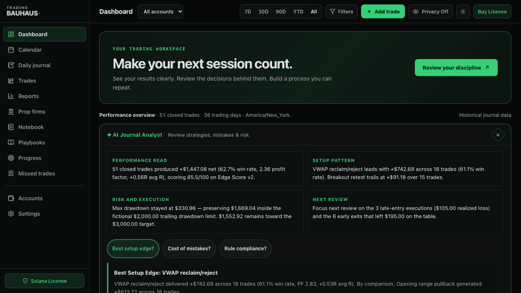
</a>

<sub><strong>Live Interactive Showcase</strong> — Real-time walkthrough of the <a href="https://annoris.github.io/trading-bauhaus-journal/">Trading Bauhaus GitHub Pages demo</a>: AI Journal Analyst, Edge Score v2 Radar, Trades Explorer, OHLC Candlestick Replay, Monthly P&amp;L Calendar, Setups &amp; Mistakes, Daily Playbooks, and Prop Firm Cash ROI Ledger.</sub>

</div>

---

## 🔒 Public Preview vs. Full Self-Hosted Edition

> **Important Notice:** This public repository hosts the **interactive read-only web showcase (`site/`)** and visual documentation so you can test the entire UI live in your browser at **[annoris.github.io/trading-bauhaus-journal](https://annoris.github.io/trading-bauhaus-journal/)**.
>
> The **complete self-hosted application** (`Next.js 15` + isolated `SQLite` databases + `14` statement importers + `22` read-only broker sync adapters + **Claude / OpenAI BYOK AI Analyst** + encrypted `.tbjbackup` CLI + `Docker Compose`) is hosted privately in **`annoris/trading-bauhaus-journal-pro`** and unlocked exclusively for verified **Solana (`SOL`) contributors** or commercial license holders. [Jump to Unlock Instructions ↓](#full-self-hosted-edition-solana-contribution-gated)

---

## Why Trading Bauhaus vs. SaaS Trading Journals?

| Capability | **Trading Bauhaus AI** | TradeZella / Tradervue | Spreadsheets |
| :--- | :---: | :---: | :---: |
| **Monthly SaaS Subscription** | **$0/mo** (One-time SOL access) | \$29 – \$49 / month forever | Free |
| **AI Trading Analyst (Claude & OpenAI BYOK)** | **Built-in** (zero telemetry, your key) | Paid tier / cloud-hosted data | None |
| **OHLC Candlestick Trade Replay** | **Built-in** (step, play, scrub, MAE/MFE) | Higher-tier add-on | None |
| **Data Ownership & Privacy** | **100% Local SQLite + AES-256-GCM** | Vendor cloud servers | Local |
| **Broker Sync & Statement Importers** | **22 Broker Syncs + 14 Importers** | Broker-dependent | Manual |
| **Prop Firm True Cash ROI Ledger** | **Built-in** (fees, resets, payouts) | Limited / manual | Manual |
| **Auditable Math (`Edge Score v2`)** | **Transparent 6-axis formula** | Proprietary black box | Custom |

---

## AI Journal Analyst (Claude & OpenAI BYOK)

Modern traders don't need another generic chatbot — they need **grounded, execution-level diagnostics** tied directly to real fills, setups, and rule compliance:

- **Bring Your Own Key (Claude / OpenAI):** Connect your Anthropic (`ANTHROPIC_API_KEY`) or OpenAI (`OPENAI_API_KEY`) key directly inside your self-hosted instance. Requests go straight from your machine to your provider — **never** through third-party journal analytics servers.
- **Grounded Over Active Filters:** Every AI session recap, trade critique, and Q&A prompt reads exact metrics from your currently filtered window (`7D`, `30D`, `90D`, `All`), symbol (`NQ`, `MNQ`, equities, crypto, FX), setup tag, and mistake tags.
- **Actionable Execution Audits:** Instantly surface your highest-expectancy setup, exact dollar cost of `late entry` / `early exit` / `slipped stop` mistakes, trailing drawdown pressure, and playbook adherence rate.

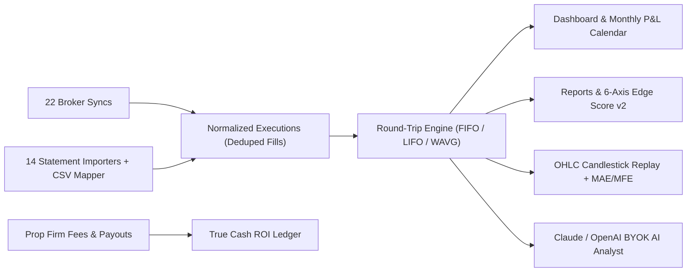

---

## Visual Walkthrough

Every screenshot below was captured directly from the live rendered interface (`1440×900` desktop and `390×844` `@2x` mobile):

### 1. Dashboard Overview & AI Journal Analyst (`#view=dashboard`)

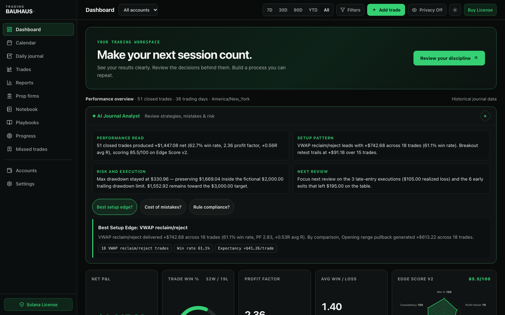

- **On Screen:** Obsidian `#090b0b` Bauhaus terminal with Window (`7D`, `30D`, `90D`, `All`) and Symbol filters, **AI Journal Analyst** briefing cards + interactive prompt chips, 5 executive KPI cards (including the **Trade Win %** gauge, **Avg Win / Loss** bar, and 6-axis **Edge Score v2** radar), live equity curve, and one-click **Privacy Mask (`$••••`)**.

---

### 2. Trades Explorer (`#view=trades`)

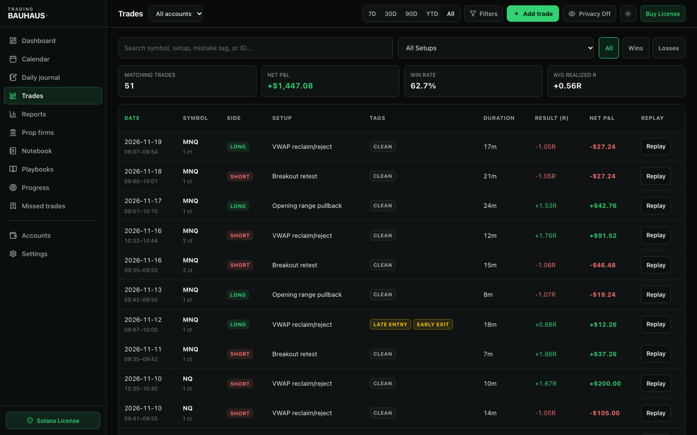

- **On Screen:** Full-width search, setup & outcome filters, live matching KPIs (`Matching Trades`, `Net P&L`, `Win Rate`, `Avg Realized R`), sortable execution ledger with mistake tags (`late entry`, `early exit`, `slipped stop`, `clean`), and one-click **Replay** triggers.

---

### 3. Trade Detail & OHLC Candlestick Replay (`<dialog id="trade-modal">`)

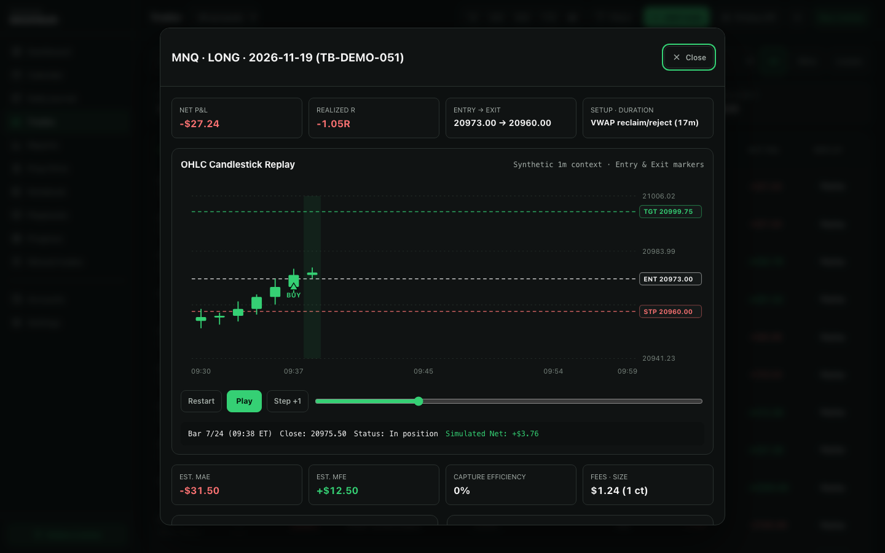

- **On Screen:** Native `<dialog>` OHLC candlestick replay with `TGT`, `ENT`, and `STP` reference lines, `BUY`/`SELL` & `EXIT` markers, `Restart` / `Play` / `Step +1` controls, interactive bar scrubber, live bar-by-bar unrealized P&L, Est. MAE/MFE, Capture Efficiency, and playbook rule checklist.

---

### 4. Monthly P&L Calendar & Session Inspector (`#view=calendar`)

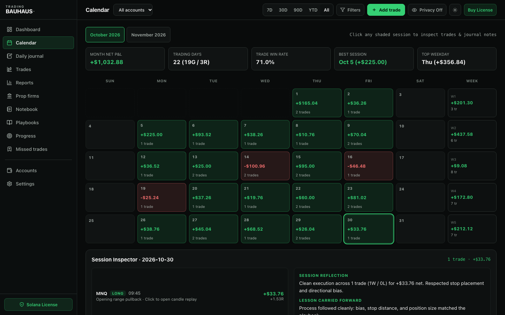

- **On Screen:** 8-column `Sun–Sat + Weekly Total` heatmap with monthly insight cards (`Month Net P&L`, `Trading Days`, `Win Rate`, `Best Session`, `Top Weekday`) and click-to-inspect daily trades & reflections.

---

### 5. Reports & Quantitative Analytics (`#view=reports`)

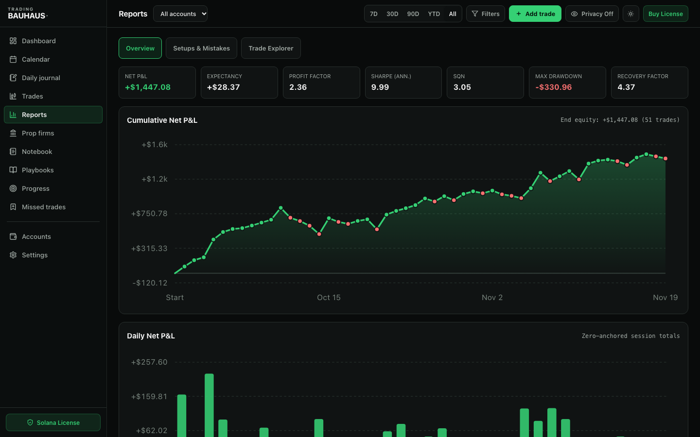

- **On Screen:** Seven statistical KPI cards (`Net P&L`, `Expectancy`, `Profit Factor`, `Sharpe`, `SQN`, `Max Drawdown`, `Recovery Factor`), full-width Cumulative Net P&L curve, and zero-anchored Daily Net P&L bars.

---

### 6. Setups & Mistakes Breakdown (`#view=reports`)

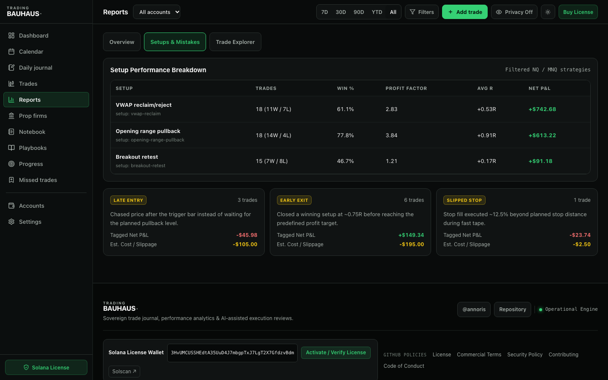

- **On Screen:** Setup Performance Breakdown table paired with quantified Mistake Impact cards showing exact dollar drag per mistake category, plus the **Trade Explorer** duration-vs-P&L scatter plot.

---

### 7. Daily Journal, Discipline Playbook & Prop Firms (`#view=journal`)

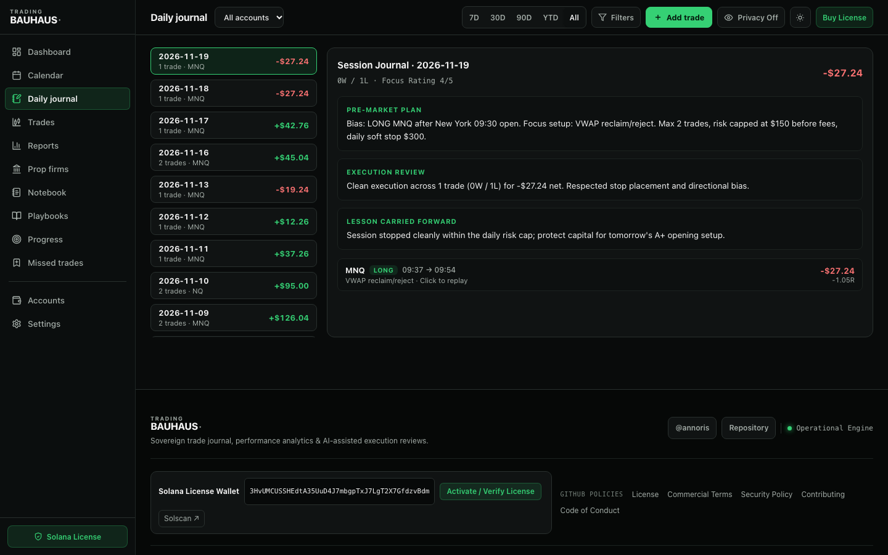

- **On Screen:** Chronological session journal (`Pre-Market Plan`, `Execution Review`, `Lesson Carried Forward`), live playbook rule adherence percentages, and an independent **Prop Firms Cash ROI Ledger** separating evaluation/reset fees from payouts.

---

### 8. Responsive Mobile Terminal (`390×844 @2x`)

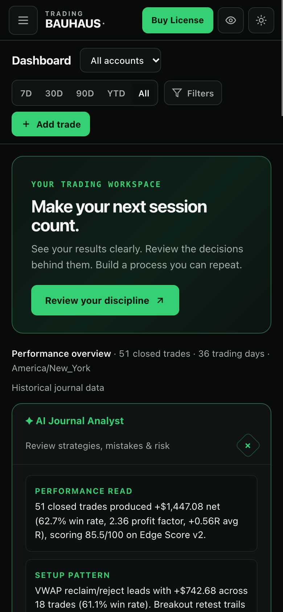

- **On Screen:** Sticky header with `Privacy`, `Light/Dark` theme toggle, accessible slide-over navigation drawer, horizontal workspace tabs, `44px` touch targets, and verified zero horizontal overflow.

---

## Core Capabilities Included in the Private Full Edition (`trading-bauhaus-journal-pro`)

| Module | What You Unlock |
| :--- | :--- |
| **Broker Sync (22 Providers)** | Read-only sync for Alpaca, Binance, Bybit, Coinbase, Kraken, OKX, Tradier, IBKR Flex, Hyperliquid, Questrade, Topstep, Trading212, Webull, Crypto.com, E\*TRADE, Public, Charles Schwab, TradeStation, tastytrade, Robinhood Crypto, Gemini, and KuCoin. |
| **14 Statement Importers** | Auto-detects TradeZella, Tradervue, TradingView, MetaTrader 4/5, ThinkorSwim, IBKR (Activity + Flex), NinjaTrader, Tradovate, TopstepX, Webull, DAS Trader, plus custom CSV column mapper & execution deduplication. |
| **Round-Trip Math Engine** | Pure TypeScript FIFO / LIFO / weighted-average matching, realized R multiples, drawdown curves, Sharpe/Sortino/SQN, and 6-axis **Edge Score v2**. |
| **BYOK AI Reflection** | Native **Anthropic Claude** & **OpenAI** integration running server-side on your own machine with AES-256-GCM encrypted key storage. |
| **Isolated Multi-User SQLite & Backups** | Separate SQLite database per user, 7-day one-time invite links, encrypted `.tbjbackup` snapshot/restore CLI, and ready-to-run `Docker Compose` + Caddy reverse-proxy templates. |

---

## Full Self-Hosted Edition (Solana Contribution-Gated)

To prevent unauthorized redistribution while funding independent development, the full self-hosted source code (`annoris/trading-bauhaus-journal-pro`) is available exclusively to verified **Solana (`SOL`)** contributors and commercial license holders.

<div align="center">


**Official Solana (`SOL` / `USDC-SPL`) Wallet:**

```text
3HvUMCUSSHEdtA35UuD4J7mbgpTxJ7LgT2X7GfdzvBdm
```

[](https://solscan.io/account/3HvUMCUSSHEdtA35UuD4J7mbgpTxJ7LgT2X7GfdzvBdm)
[](https://annoris.github.io/trading-bauhaus-journal/#view=license)

</div>

### How to Unlock Private Repository Access (3 Steps)

1. **Send your contribution via Solana (`SOL` or `USDC-SPL`)** to `3HvUMCUSSHEdtA35UuD4J7mbgpTxJ7LgT2X7GfdzvBdm` (Solana mainnet only).
2. **Open a GitHub Issue** in this repository (or reach out to `@annoris`) including your **Solscan transaction signature/link** and your **GitHub username**.
3. **Receive your private collaborator invite** to **`annoris/trading-bauhaus-journal-pro`** with full access to the Next.js 15 + SQLite + Docker + AI Analyst codebase and future updates.

---

## Disclaimer, Policies & License

- **No Financial Advice:** Trading Bauhaus analyzes execution records you provide. Nothing computed or generated (including simulated demo briefings or AI critiques) is investment advice. All live demo figures use a fictional 51-trade NQ/MNQ dataset.
- **Commercial & Contribution-Gated License:** Owned 100% by **Trading Bauhaus (Annoris)** under `LicenseRef-TradingBauhaus-Commercial-1.0`. Unauthorized redistribution, resale, or public SaaS hosting is strictly prohibited. See [`LICENSE`](LICENSE), [Commercial License Guide](docs/commercial-license.md), [`SECURITY.md`](SECURITY.md), and [Screenshot Suite Guide](docs/screenshots/README.md).

---

## More Projects by Annoris

- [**Aetheris**](https://github.com/annoris/aetheris) — AI Agent & Automation Platform (77 specialized agents, 328 workflow skills, MCP & hooks dashboard for Claude Code, Cursor & Codex)
- [**TabVento**](https://github.com/annoris/tabvento) — Modern browser tab & workspace organizer built for focus and speed
- [**Aurelia**](https://github.com/annoris/aurelia) — Refined web experience and design showcase by Annoris
- [**Solmora**](https://github.com/annoris/solmora) — Buildless HTML5, CSS3 & Vanilla JS Mediterranean editorial showcase

---

## 🌐 Explore the JAP INTERNATIONAL & Annoris Ecosystem

Built by **JAP INTERNATIONAL** — Local-First AI Automation Platforms for Small & Medium Businesses (SMBs), agencies, clinics, e-commerce, and enterprise teams, alongside 60 FPS Creative Web Engineering showcases. Every project below includes an instant **Live Demo (zero login required)**.

### 🤖 AI & Local-First Business Automation
| Project | What It Solves | Stack | Live Demo |
| :--- | :--- | :--- | :---: |
| [**`aetheris`**](https://github.com/annoris/aetheris) | 77 AI Agents, 328 Skills & Local-First Automation Control Plane | Bun · Node · Ollama · MCP | [Live Demo ↗](https://annoris.github.io/aetheris/) |
| [**`aurelia`**](https://github.com/annoris/aurelia) | Self-Hosted Business AI Automation, RAG, Workflows & Local CRM | React 18 · Express · Prisma | [Live Demo ↗](https://annoris.github.io/aurelia/) |
| [**`lumenpitch`**](https://github.com/annoris/lumenpitch) | AI Presentation Studio & Multi-LLM Slide Generation Engine | Next.js 16 · FastAPI · Electron | [Live Demo ↗](https://annoris.github.io/lumenpitch/) |
| [**`tabvento`**](https://github.com/annoris/tabvento) | Autonomous AI Browser Automation Dashboard (Local-First BYOK) | Python · Playwright · SQLite | [Live Demo ↗](https://annoris.github.io/tabvento/) |
| **`trading-bauhaus-journal`** *(You are here)* | AI Trading Journal with Claude/OpenAI Analyst & OHLC Replay | Next.js 15 · TypeScript · SQLite | [Live Demo ↗](https://annoris.github.io/trading-bauhaus-journal/) |

### 🎨 Creative Engineering & 60 FPS Web Showcases
| Project | Experience & Motion Engineering | Stack | Live Demo |
| :--- | :--- | :--- | :---: |
| [**`kairo`**](https://github.com/annoris/kairo) | 60 FPS Spatial Web: Navier-Stokes Fluid, GLSL Shaders & Rapier 3D | Next.js 14 · Three.js · GLSL | [Live Demo ↗](https://annoris.github.io/kairo/) |
| [**`valence`**](https://github.com/annoris/valence) | Zero-Bundler 60 FPS Awwwards Agency Template (MIT) | HTML5 · CSS3 · GSAP · Lenis | [Live Demo ↗](https://annoris.github.io/valence/) |
| [**`luma`**](https://github.com/annoris/luma) | Zero-Dependency Botanical Brand Experience + 106 BPM Web Audio Synth | HTML5 · CSS3 · Web Audio API | [Live Demo ↗](https://annoris.github.io/luma/) |
| [**`valtor`**](https://github.com/annoris/valtor) | Luxury Automotive Digital Flagship — 60 FPS GSAP + SplitText | Vite · ES Modules · GSAP | [Live Demo ↗](https://annoris.github.io/valtor/) |
| [**`solterra`**](https://github.com/annoris/solterra) | Luxury Desert Architecture Showcase — GSAP ScrollSmoother | React 19 · Vite 6 · Tailwind 4 | [Live Demo ↗](https://annoris.github.io/solterra/) |
| [**`moxie`**](https://github.com/annoris/moxie) | Bold Social-First Creative Agency Experience — GSAP Inertia | Next.js 15 · React 19 · Lenis | [Live Demo ↗](https://annoris.github.io/moxie/) |
| [**`kineta`**](https://github.com/annoris/kineta) | Locked-60fps Brutalist Editorial Showcase & Variable Font Physics | Vanilla JS · GSAP · Lenis | [Live Demo ↗](https://annoris.github.io/kineta/) |
| [**`solmora`**](https://github.com/annoris/solmora) | Editorial Mediterranean E-Commerce Showcase (MIT, Zero-Deps) | HTML5 · CSS3 · Vanilla JS | [Live Demo ↗](https://annoris.github.io/solmora/) |

> ⭐ **Enjoyed exploring this project?** Drop a **Star** on GitHub and check out the full portfolio at [**github.com/annoris**](https://github.com/annoris) — it helps other builders discover the ecosystem!
